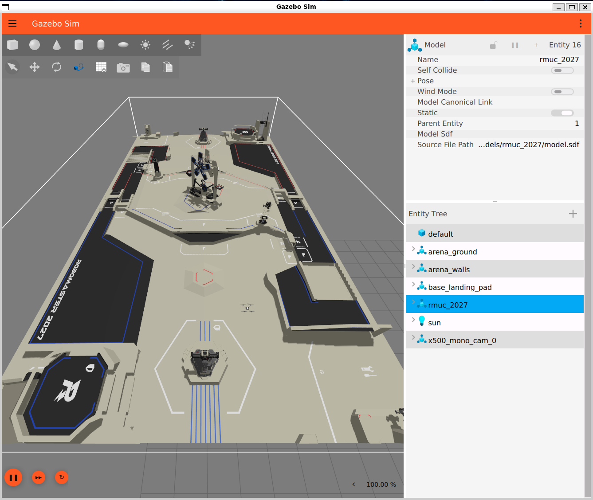

# RM27 无人机导航仿真

WSL2 Ubuntu 26.04 上的 PX4 SITL + Gazebo Jetty 仿真环境，场地用 RMUC 2027
官方 STP 转出的实体网格，任务是"已知地图 + A* 规划 + offboard 航点飞行"的避障航线验证。
渲染走本机 RTX 5070 Ti。



场地不使用贴图：官方 `RMUC2027_V1.0.0.stp` 经 OCCT 三角化，按 XCAF 的逐面颜色
分成 9 组网格，颜色和布局都来自原始 CAD，构建流程见
[tools/step_to_arena/](tools/step_to_arena/)。

配套文档：

| 文档 | 内容 |
|---|---|
| [docs/TERMINAL_SLAM_GAZEBO.md](docs/TERMINAL_SLAM_GAZEBO.md) | 终端调参、参数速查、Gazebo 操作、SLAM 接入方案 |
| [docs/arena_texture.md](docs/arena_texture.md) | 早期贴图方案，已弃用，保留作历史记录 |
| [tools/step_to_arena/](tools/step_to_arena/) | 官方 STP 到场地网格的构建脚本与踩坑记录 |
| [ORB_SLAM3](https://github.com/MalzaharGeng/ORB_SLAM3) | 双目 VIO、PX4 外部视觉桥、相机规格与仿真配置 |
| [docs/specs/2026-10-31-px4-gazebo-ubuntu2604-design.md](docs/specs/2026-10-31-px4-gazebo-ubuntu2604-design.md) | 环境选型与验收标准 |
| [docs/worklog/](docs/worklog/) | 11-03 / 11-04 两天的排障过程 |
| [docs/flight_records/](docs/flight_records/) | 实飞日志（nav_positions.csv、mission.log、PX4 控制台） |

## 环境

| 项目 | 版本 / 配置 |
|---|---|
| 宿主 | Windows 11 + WSL2，`networkingMode=mirrored` |
| 发行版 | Ubuntu 26.04.1 LTS，glibc 2.43，32 核 / 15 GiB |
| ROS | ROS 2 Lyrical（`/opt/ros/lyrical`） |
| Gazebo | `ros-lyrical-ros-gz` 3.0.10 自带 gz-sim 10.5.0（Jetty） |
| 飞控 | PX4-Autopilot v1.17.0，仅 SITL |
| 机载接口 | MAVSDK 4.0.5 grpc 版（`from mavsdk_grpc import System`） |
| GPU | RTX 5070 Ti Laptop，Mesa D3D12 + WSLg，OpenGL 4.6 |

PX4 官方只认证到 24.04，26.04 靠 ROS 的 gz vendor 包对齐版本，所以 PX4 必须
锁 v1.17.0（上游在 #25521 里才支持 Jetty）。

## 已验证

有日志或运行输出支撑的部分：

- `glxinfo -B` 在 `GALLIUM_DRIVER=d3d12` + `MESA_D3D12_DEFAULT_ADAPTER_NAME=NVIDIA`
  下报 `D3D12 (NVIDIA GeForce RTX 5070 Ti Laptop GPU)`、`Accelerated: yes`
- RMUC 2027 场地（28 × 16 m，含围栏）能加载，9 组实体网格颜色正确（截图见上），物理为 dart，围栏与抬升平台有碰撞体
- PX4 v1.17.0 SITL 编译通过，`make px4_sitl gz_x500` 在场地内起飞
- offboard 方形航点飞完一圈，位置日志见 `docs/flight_records/offboard_positions.csv`
- `nav_planner.py` 13 项单元测试通过，`rm27_nav.py --dry-run` 能离线输出完整航线
- 四段避障演示：直飞 37.7 m / 规划 42.95 m / 4 个拐点 / 最窄余量 1.76 m
- 直飞远端基地：直飞 19.80 m / 规划 20.03 m / 实飞 21.04 m，最高 0.58 m/s，
  全程离障碍最近 1.24 m（`docs/flight_records/enemy_base_test.csv`）

## 目录

```
RM27_drone_sim
├── env.sh                    环境变量（PATH、GPU、世界、出生点）
├── start_rm27_px4.sh         启动 PX4 SITL + Gazebo（GPU 预检、世界与模型同步）
├── stop_sim.sh               收尾，确认无残留进程
├── PX4-Autopilot/            v1.17.0 源码（按下方步骤单独 clone，不入库）
├── rm27_sim/                 场地与独立查看器
│   ├── run_rm27.sh           Linux/WSL 下只开场地（不接 PX4）
│   ├── start_rm27.ps1        Windows + pixi 版
│   ├── pixi.toml             pixi 依赖（win-64，gz-sim 10.*）
│   ├── worlds/
│   │   ├── rm27_world.sdf        纯场地
│   │   ├── rm27_nav_world.sdf    场地 + 导航障碍块
│   │   └── rm27_gui.config       GUI 布局与面板
│   └── models/
│       ├── rmuc_2027/            场地：model.sdf + meshes/color_*.stl（9 组，约 117 MB）
│       └── nav_obstacles/        1 个高地柱 + 2 个 3 m 方块（带碰撞）
├── tools/
│   └── step_to_arena/        STP → 网格 → SDF 的构建脚本
├── scripts/
│   ├── nav_planner.py        网格 A*，纯标准库
│   ├── rm27_nav.py           带避障的航点任务（含安全中断）
│   ├── rm27_waypoints.py     最早那版方形航点，无避障
│   ├── test_nav_planner.py   规划器单元测试
│   ├── run_nav_demo.sh       全流程：起仿真 → 飞任务 → 关仿真
│   ├── obstacles_rm27.json   障碍与目标点（Gazebo 世界坐标）
│   └── obstacles_rm27_plain.json  纯场地版本
└── docs/
```

## 安装 PX4

仓库里不含 PX4 源码，按下面的顺序放在 `RM27_drone_sim/PX4-Autopilot`：

```bash
cd ~/drone_sim
git clone -b v1.17.0 --recursive https://github.com/PX4/PX4-Autopilot.git PX4-Autopilot
bash PX4-Autopilot/Tools/setup/ubuntu.sh      # 装依赖，装完重新登录一次
cd PX4-Autopilot && make px4_sitl gz_x500     # 先确认官方例子能起飞
```

第一次 `make px4_sitl` 会编十分钟左右，产物在
`PX4-Autopilot/build/px4_sitl_default/bin/px4`。之后本项目的启动脚本直接用这个
build 目录，不会重编。

## 运行前

```bash
cd ~/drone_sim
source ./env.sh
```

`env.sh` 固定了渲染路径，缺了它 Gazebo 会掉到 llvmpipe 软件渲染：

```bash
export GALLIUM_DRIVER=d3d12
export MESA_D3D12_DEFAULT_ADAPTER_NAME=NVIDIA
export QT_QPA_PLATFORM=xcb QT_XCB_GL_INTEGRATION=xcb_glx QT_OPENGL=desktop
```

自检：

```bash
glxinfo -B | grep -E "Device|Accelerated"
# 期望 D3D12 (NVIDIA GeForce RTX 5070 Ti Laptop GPU) / Accelerated: yes
```

机器上还有一块 AMD 610M 核显，D3D12 默认会挑它，所以 NVIDIA 是显式指定的。

## 运行方法

先离线看航线，不碰仿真：

```bash
python3 scripts/test_nav_planner.py       # 13 项单元测试
python3 scripts/rm27_nav.py --dry-run     # 打印每条航段、拐点与余量
```

一次跑完整个流程（起仿真 → 等 PX4 的 gz_bridge → 飞任务 → 关仿真）：

```bash
chmod +x scripts/*.sh    # 只第一次需要
./scripts/run_nav_demo.sh
```

飞指定 ENU 世界坐标（x 向东、y 向北）：

```bash
./scripts/run_nav_demo.sh --target 25.75,8 --hold 5     # 飞到远端基地
PX4_GZ_WORLD=rm27_world ./scripts/run_nav_demo.sh --enemy-base --hold 5   # 纯场地对照
```

分步运行（需要单独观察 Gazebo 窗口时）：

```bash
PX4_GZ_WORLD=rm27_nav_world ./start_rm27_px4.sh                 # 终端 A
cd ~/drone_sim && source ./env.sh && python3 scripts/rm27_nav.py # 终端 B
./stop_sim.sh
```

PX4 和 Gazebo 的输出写进 `logs/sim_console.log`，任务日志写进
`logs/nav_positions.csv`，出问题先看这两个。

只开场地、不接飞控：

```bash
cd rm27_sim && ./run_rm27.sh
```

场地实测坐标（从当前网格聚类，z > 1.2 m 的结构）：

| 结构 | 中心 (x, y) | 高度 |
|---|---|---|
| 近端基地 | (2.50, 8.00) | 1.7 m |
| 远端基地 | (25.75, 8.00) | 1.7 m |
| 中央高地 | (14.1, 7.9) | 3.8 m |

出生点 `(5, 6)`，最远的基地在本地 NED 里是 `N=2.0, E=20.75`。远端基地装甲板
前沿在 `x≈25.52`，直接飞中心会和装甲板重合，`--enemy-base` 用
`base_far_front = (24.7, 8.0)` 作落点。

## 场地模型

`rm27_sim/models/rmuc_2027/` 下的网格来自官方 `RMUC2027_V1.0.0.stp`
（653 MB，CREO 导出），不手工建模、不贴图：

| 文件 | 内容 | 面数 |
|---|---|---|
| `meshes/color_black.stl` | 地面主体 | 42,168 |
| `meshes/color_beige.stl` | 围栏与框架 | 52,851 |
| `meshes/color_darkgrey.stl` | 桁架与设备 | 7,132 |
| `meshes/color_red.stl` | 红方线条 | 2,487 |
| `meshes/color_blue.stl` | 蓝方线条 | 2,514 |
| `meshes/color_deepblue.stl` | 暗部装饰 | 798 |
| `meshes/color_grey.stl` | 过渡件 | 1,502 |
| `meshes/color_white.stl` | 高光件 | 820 |
| `meshes/color_cyan.stl` | 青色装饰 | 293 |

构建流程：XCAF 建装配 → 12 mm 三角化 → 逐面取色 → 9 色聚类 → STL + SDF。
脚本、依赖和踩过的坑都在 [tools/step_to_arena/](tools/step_to_arena/)。
9 个 STL 共约 117 MB，首次加载 10–20 秒。

坐标 x 0.149..28.149、y 0.064..16.067、z 0.019..3.817，与旧 STL 逐位一致；
`arena_ground` 和 `arena_walls` 的碰撞体没有改，导航和降落逻辑不受影响。

## 避障实现

不靠机载传感器，靠已知地图：

- `obstacles_rm27.json` 里是轴对齐矩形（四面围栏 + 中央高地 + 两个方块），与
  `nav_obstacles/model.sdf` 的碰撞体一一对应，改一处要同步改另一处
- 纯场地没有方块，用 `obstacles_rm27_plain.json`；`run_nav_demo.sh` 按世界名自动选
- 规划器 0.2 m 网格 A*，障碍按 1.2 m 膨胀（机体半径 + 跟踪误差），八邻域、
  禁止切角，最后用视线法把网格拐点压成直线段
- 折线按 0.5 m 加密再发给 PX4：给远处的点会按 `MPC_XY_VEL_MAX` 全速冲，
  小步递进速度自然只有 1–2 m/s
- 飞行时 5 Hz 流式发 setpoint，实时算到最近障碍的距离，低于 0.6 m 或高度
  偏离超过 0.8 m 就中断、退出 offboard 并降落
- setpoint 的 yaw 按"当前航段起点 → 目标点"算，机头始终朝向目标
- 到最后一个点先降到 `--final-hover-altitude`（默认 0.8 m），在基地下层装甲板前
  悬停 `--hold` 秒再 `land()`，设 0 可跳过

早先 0.8 m 膨胀时最窄余量只有 1.27 m，跟踪误差一大就撞进 0.6 m 中断线；
现在膨胀 1.2 m，余量 1.76 m 起。

## 坐标系

- Gazebo 世界是 ENU：x 向东、y 向北、z 向上，单位米
- PX4 本地 NED：北 = 世界 y − 出生点 y，东 = 世界 x − 出生点 x，下 = −高度
  （`GZBridge.cpp` 里是 `(north, east) = (gz.y, gz.x)`，不是直接相减）
- 出生点由 `PX4_GZ_MODEL_POSE=5,6,0.5,0,0,0` 决定，改出生点要同步改
  `obstacles_rm27.json` 的 `spawn_world_xy`
- 换算统一走 `nav_planner.world_to_ned()`，别在别处手写减法

## 已知问题

- **把世界 x 当北会撞"空气墙"**：早期版本飞远端基地在 `N≈9.5` 处撞北侧围栏，
  日志里高度骤降到 1 m。根因是 ENU/NED 的 x、y 对调，现在所有换算集中在一个函数，
  单元测试里锁了围栏的 NED 边界
- **世界文件必须同步到 PX4 的 worlds 目录**：`gz sim -r` 只认
  `Tools/simulation/gz/worlds/`，项目里的副本不会被自动发现，启动脚本每次先同步
- **同步不能无脑 `cp`**：`rm27_world.sdf` 在 PX4 目录里是硬链接，`cp` 会以
  `are the same file` 非零退出，配合 `set -e` 直接让启动脚本死掉。脚本先比 inode
- **`GZ_SIM_RESOURCE_PATH` 会被 PX4 覆盖**：`simulation-gazebo` 启动 gz 时指向自己的
  models 目录，`env.sh` 里设的值不生效，所以模型要软链进那个目录，否则世界能开但场地是空的
- **位置 setpoint 给太远会砸机**：首版直接给 11 m 外的点，PX4 按 12 m/s 上限冲，
  实测 7.1 m/s，过冲后姿态发散从 2 m 掉到地面。现在靠 0.5 m 加密 + 限速 2.0 m/s
- **场地网格没有碰撞体**：远端基地前那块抬升平台顶面在 z≈0.318 m，碰撞地面在
  z=0.019 m，直接降落会陷进网格，世界文件里补了 `base_landing_pad` 碰撞盒
- **MAVSDK 端口**：遥测 14550、offboard 14540；WSL 用 mirrored 网络，Windows 侧
  QGC 连 `localhost:14550`
- **offboard 必须持续发 setpoint**：停超过 1 s PX4 会退出 offboard 并悬停/降落
- **没仿真时 `rm27_nav.py` 要等 30 秒才报错**：连接和位置估计都有超时保护，
  不会像第一版那样挂死

## 待办

1. 场地已改实体渲染，贴图方案停用；9 个主色是聚类结果，如果要逐面保留 319 色，
   需要先解决 Gazebo 的材质切换开销
2. 机载视觉（相机 + VIO）还没接进 SITL，方案在
   `docs/TERMINAL_SLAM_GAZEBO.md` 第 3 节，未实机验证；双目配置与相机规格在
   [ORB_SLAM3](https://github.com/MalzaharGeng/ORB_SLAM3)
3. 多机与动态障碍不在当前范围内
