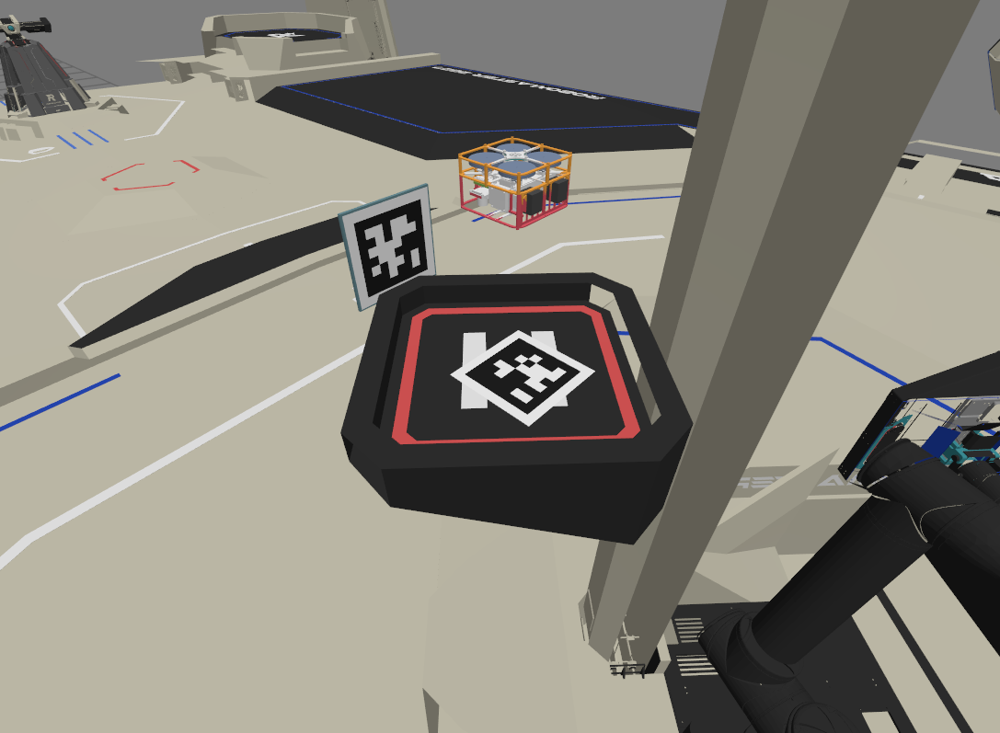
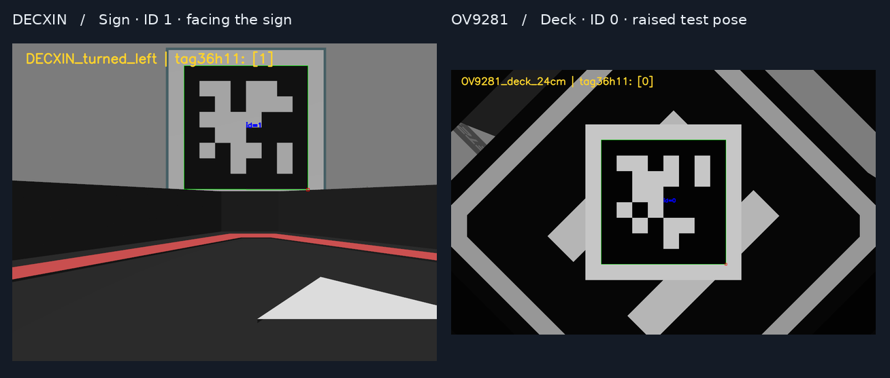

# RM27 无人机导航仿真

RMUC 2027 场地的 PX4 SITL 和 Gazebo 环境。默认场景使用 Drone-Harrier 小四旋翼，从场地中央近侧的 H 字机库平台出生。X500 留作地面翻正的对照。



## Harrier 机库

[机体模型](rm27_sim/models/drone_harrier/)沿用原护笼和碰撞网格。硬件配置为 DECXIN 前视双目、微空 743 V2 AIO 35A、香橙派 CM5（RK3588S，4 GB + 32 GB）和四组 T-MOTOR 1204 6500 KV / 1816 桨；机腹为 OV9281 下视灰度相机（1280×800，仿真目标 120 Hz）。质量、惯量和电机响应沿用原 SITL 参数。

台面放置 tag36h11 ID 0；立牌 ID 1 在平台中心镜像后的对侧，朝向台面。默认机头方向不变，停机时前视双目看不到立牌；仿真中原地转向 180° 后，左右目均读到 ID 1。下视相机抬高后读到台面 ID 0。两张相机画面取自不同检查姿态。



只看场景可从仓库根目录执行 `bash rm27_sim/run_rm27.sh`。下视 ROS 2 话题见[机库联调说明](docs/HARRIER_HANGAR.md)。

## 仿真功能

| 功能 | 实现 | 文档 |
| --- | --- | --- |
| RMUC 2027 场地 | 官方 STP 经 OCCT 三角化；按 CAD 逐面颜色导出九组网格。Harrier 原场地使用分色外观和网格碰撞。 | [场地构建](tools/step_to_arena/) |
| 双目惯性导航 | Harrier 双目与 IMU 数据经 ROS 2 接入 ORB-SLAM3，定位结果送入 PX4；Gazebo 真值用于独立监督和误差评价。 | [运行配置](experiments/vio_20261120/README.md) · [联调记录](docs/VIO_HARRIER_20261120.md) |
| PX4 地面侧翻恢复 | 飞控在落地、未解锁且姿态满足进入条件时输出恢复力矩。Harrier SITL 根据姿态和角速度调节电机输出，覆盖侧躺和完全倒扣工况。 | [实现与改动](docs/PX4_FLIP_RECOVERY.md) · [Harrier 验证](docs/verification/harrier_flip_20261122/README.md) |
| 已知地图规划 | A* 按场地障碍图生成航点，经 PX4 Offboard 接口执行。 | [操作说明](docs/TERMINAL_SLAM_GAZEBO.md) |

侧翻恢复由飞控执行，PX4 通用配置默认关闭（`FLIP_EN=0`）；启用后须切入 Flip Recovery 模式。该功能只在落地且未解锁时出力，不参与飞行中的姿态保护。Harrier 与 X500 的翻正试验均由 Gazebo 输出桥驱动电机，不依赖 ORB-SLAM3。

## 上游项目与本仓库改动

| 来源 | 本仓库的使用方式 |
| --- | --- |
| [PX4/PX4-Autopilot](https://github.com/PX4/PX4-Autopilot)，v1.17.0 | 提供飞控、SITL 和 Gazebo 接入基础。 |
| [natgeng/PX4-MicoAir743v2-AIO · feat/flip-recovery](https://github.com/natgeng/PX4-MicoAir743v2-AIO/tree/feat/flip-recovery) | 提供 MicoAir 板级支持及原始翻正模式、参数和状态接口；本仓库收录接入后的 PX4 完整源码快照。 |
| [MalzaharGeng/ORB_SLAM3](https://github.com/MalzaharGeng/ORB_SLAM3) | 提供 Harrier 双目惯性定位和 PX4 外部视觉接口；算法在配套仓库维护。 |
| RMUC 2027 官方 CAD | 提供场地几何与颜色，转换脚本和 Gazebo 资源在本仓库维护。 |

本仓库的翻正改动分为两层：PX4 源码补齐 DShot 自动换向与方向恢复，修正电机高度排序、油门映射和有向进度，增加停油后的稳定判定；SITL 试验单独应用 Gazebo 可逆输出补丁，并记录禁用输出、默认参数和调参组的结果。每项改动的代码位置和验证依据见[翻正实现与改动说明](docs/PX4_FLIP_RECOVERY.md)，源码与固定依赖见 [PX4 构建说明](docs/PX4_SOURCE.md)。

## 构建与运行

验证环境为 Windows 11 / WSL2 Ubuntu 26.04、ROS 2 Lyrical、Gazebo Jetty（gz-sim 10.5.0）和 PX4 v1.17.0。场地渲染使用 WSLg；实验机的 GPU 为 NVIDIA RTX 5070 Ti Laptop。

从本仓库根目录导出独立 PX4 源码树。依赖和环境准备见 [PX4 构建说明](docs/PX4_SOURCE.md)。

```bash
python3 tools/px4/create_build_tree.py --output "$HOME/rm27_px4_source" --submodules
source /opt/ros/lyrical/setup.bash
make -C "$HOME/rm27_px4_source" px4_sitl_default
```

- **Harrier 双目惯性导航：** 按[实验运行说明](experiments/vio_20261120/README.md)配置模型、参数和运行目录。
- **Harrier 地面侧翻与倒扣恢复：** 按[Harrier SITL 构建与运行](tools/flip_recovery/harrier/README.md)准备独立构建，再用 `bash start_rm27_px4.sh --flip-recovery` 启动。
- **旧 X500 对照：** 按[复现流程](docs/verification/flip_recovery_20261121/README.md#仿真配置与复现)在独立 PX4 树应用试验补丁，运行配对场景并生成评分。
- **已知地图 A*：** 在仓库根目录加载 `env.sh` 后，执行 `python3 scripts/rm27_nav.py --dry-run` 检查航线；仿真入口为 `./scripts/run_nav_demo.sh`。

## 目录

| 路径 | 内容 |
| --- | --- |
| [PX4-Autopilot/](PX4-Autopilot/) | PX4 源码快照、翻正模块、DShot 驱动和回归用例 |
| [rm27_sim/](rm27_sim/) | Gazebo 场地、机体、传感器和碰撞模型 |
| [ros2/rm27_slam/](ros2/rm27_slam/) | 双目惯性输入、时间映射和跟踪诊断 |
| [scripts/](scripts/) | 仿真控制、飞手接管、航点与独立真值评价 |
| [experiments/](experiments/) | 固定配置的实验运行环境 |
| [tools/flip_recovery/](tools/flip_recovery/) | Harrier 启动入口、X500 基线脚本、评分程序和 SITL 补丁 |
| [docs/](docs/) | 工程文档与[验证记录](docs/verification/README.md) |
