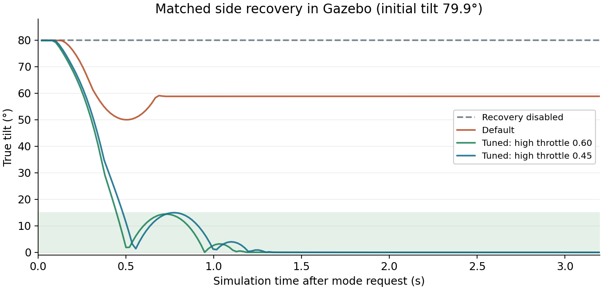

# PX4 地面翻正：Gazebo 参数筛选与配对复验（2026-11-21）

在 Gazebo X500 的 6 个侧躺配对场景中，默认参数 **0/6**，保留自动换向的调参组合 **6/6**。完全倒扣的 15 次开启翻正试验 **0/15**。本轮测试的是 PX4 地面翻正及其仿真执行链，未运行 ORB-SLAM3；此前计划的 300 次正式验收未执行。

## 测了什么

| 组别 | 测试内容 |
| --- | --- |
| 默认与禁用对照 | 同一 X500 模型和落姿，分别开启默认翻正和禁用翻正，区分主动纠正与自然回正。 |
| 参数筛选 | 改变翻转策略、高低油门、低位电机方向、油门上升率、停油角、出力上限及进度判定，记录状态机、四路电机命令和机体姿态。 |
| 配对复验 | 比较两组筛出的参数和较低高位油门的变体；覆盖左右镜像、不同航向及落高。六组有效侧躺均稳定在约 79.924° 再触发。 |
| 倒扣 | 测试接近 180° 的起始状态；覆盖两种策略、不同高低油门与朝向，确认出力后是否真正离开倒扣姿态。 |

基于仓库 [PX4 源码快照](../../PX4_SOURCE.md)（原始提交 `8313a4a342374d867518e8b4de97cfdabecfe7c0`），使用 Ubuntu 26.04 WSL、ROS Lyrical 和 Gazebo Sim 10.5.0。仅在独立 SITL 树使用[实验输出桥](../../../tools/flip_recovery/sweep/sitl_bridge.diff)，把模块的带符号电机请求送到 Gazebo；冻结源码和实机参数均未改。该桥未复现真实 DShot 的停机与换向保护，也没有实机桨载、摩擦和机架接触标定。

每轮使用独立 Gazebo 分区、发现端口和 PX4 工作目录。机体以指定姿态生成，落地稳定后才切入翻正模式；回正过程没有外力或姿态瞬移。成功要求：未解锁时出现主动电机输出；独立 Gazebo 姿态真值 ≤15°、角速度 ≤10°/秒连续至少 1 秒；观测尾段至少 2 秒电机命令为零；PX4 报成功并自行回到 Position。姿态真值和 PX4 结果分别统计。

## 结果

| 工况 | 禁用 | 默认 | 调参 B：强制低位反转 | 调参 A：自动换向 | 调参 A：高位降至 0.45 |
| --- | ---: | ---: | ---: | ---: | ---: |
| 侧躺约 79.924°，六组配对 | 0/6 | 0/6 | 6/6 | **6/6** | 5/6 |
| 倒扣约 180°，一组配对 | 0/1 | 0/1 | 0/1 | 0/1 | 未执行 |

- 默认侧躺代表试验最低到 50.023°，最终停在 58.856°，报 `NOT_SETTLED`；同初态禁用组始终约 79.924°。调参 A 六次均回到约 0°，从开始出力到模块报成功耗时 2.04–2.30 秒，随后退出到 Position。
- 高位降到 0.45 后有一次机体已回正，但 PX4 检测到姿态估计重置（`ATTITUDE_RESET`），因此只算 5/6。
- 另有一组俯仰落姿最终稳定在 56.648°，低于可设置的最小进入角 60°；主表的 4 条 `SETUP_ONLY` 记录属于该组，未计入配对分母。
- 15 次倒扣出力试验中，14 次 `NO_PROGRESS`、1 次超时。部分电机命令达到约 410 rad/s，Gazebo 真值仍回到接近 180°。本轮参数没有解决完全倒扣起翻，侧躺结果也不外推到其他机架或真机。
- 规划器和时序主机回归 64 项无失败，实际混控功能测试 1 项通过。测试夹具的工作队列提示不影响该功能用例的断言，但该用例不验证飞控实时调度。



## 仿真配置与复现

[调参 A 完整配置](sitl_side_profile.json)在试验中启用 `FLIP_EN=1`，保留 `FLIP_MODE=0`、`FLIP_LOW_MODE=0`、进入角 75° 和最小进度 3°。变化量为高/低油门 0.60/0.35、停油角 38°、油门上升率 2.0、出力上限 4.0 秒、进度判定起点 1.5 秒。该配置仅用于本 X500 仿真。

已有实验构建可直接执行下方的试验命令。首次复现时，按 [PX4 构建说明](../../PX4_SOURCE.md)导出独立构建树并准备依赖，再执行下列代码中标注的三条构建命令。补丁仅用于 SITL。

```bash
SIM_REPO="$(pwd)"                 # 在 RM27_drone_sim 仓库根目录执行
SWEEP="$SIM_REPO/tools/flip_recovery/sweep"
PX4_SOURCE=/path/to/standalone/px4
RUN_BASE="$(mktemp -d)"
source /opt/ros/lyrical/setup.bash
# 若尚未构建带实验桥的 SITL，先执行以下三条命令：
# git -C "$PX4_SOURCE" apply --check "$SWEEP/sitl_bridge.diff"
# git -C "$PX4_SOURCE" apply "$SWEEP/sitl_bridge.diff"
# make -C "$PX4_SOURCE" px4_sitl_default
source "$PX4_SOURCE/build/px4_sitl_default/rootfs/gz_env.sh"
python3 "$SWEEP/run_batch.py" "$SWEEP/confirm.json" "$PX4_SOURCE" "$RUN_BASE/confirm1" --jobs 3
python3 "$SWEEP/run_batch.py" "$SWEEP/confirm_auto.json" "$PX4_SOURCE" "$RUN_BASE/confirm_auto1" --jobs 3
python3 "$SWEEP/run_batch.py" "$SWEEP/confirm_low.json" "$PX4_SOURCE" "$RUN_BASE/confirm_low1" --jobs 3
python3 "$SWEEP/score.py" "$RUN_BASE/scored" "$RUN_BASE"/confirm{1,_auto1,_low1}
python3 "$SWEEP/compare.py" "$RUN_BASE/scored"
```

脚本依赖 ROS Lyrical 的 Gazebo Python 绑定，以及 `numpy`、`pyulog`；确认实例编号和发现端口空闲，必要时通过 `--first-instance` 改起始编号。工具目录还包含初测和两轮筛选矩阵。

## 数据

[75 次主表](results.csv) · [配对统计](paired_confirmation.csv) · [机器可读结果](results.json) · [证据清单](evidence/manifest.json)

主表含控制禁用对照和准备场景。早期共享发现端口的工具诊断批次未混入主表。仓库归档同一侧躺初态的禁用、默认、调参 A，以及倒扣和姿态重置各代表一例；每个样例有独立姿态、电机命令和原始 ULog。运行元数据中的模型路径改为相对路径，测量数据保持原样。回归日志见 [主机测试](host_regression.log) 和 [混控测试](mixer_regression.log)。
